# django-gitops

GitOps repository for the Django application ([django-app](https://github.com/filooww/django-app)). It contains the Helm chart, the encrypted secrets and the Argo CD Application. Argo CD watches this repository and keeps the cluster in sync with it: **any change is made by a commit, never by `kubectl apply` / `helm install`**.

## Repository structure

```
django-gitops/
├── argocd/
│   └── django-app.yaml           # Argo CD Application (applied once to bootstrap)
├── charts/
│   └── django-app/               # Helm chart: Django + PostgreSQL
│       ├── Chart.yaml
│       ├── values.yaml           # all settings (replicas, image tag, config, resources...)
│       └── templates/
│           ├── _helpers.tpl              # names, labels, shared env block
│           ├── django-configmap.yaml     # non-secret config
│           ├── django-secret.yaml        # created only if django.existingSecret is empty
│           ├── django-deployment.yaml    # probes, resources, securityContext
│           ├── django-service.yaml       # NodePort 30080
│           ├── migrate-job.yaml          # migrations Job
│           ├── postgres-secret.yaml      # created only if postgresql.existingSecret is empty
│           ├── postgres-service.yaml     # headless Service
│           └── postgres-statefulset.yaml # StatefulSet + PVC (volumeClaimTemplates)
└── secrets/
    └── django/                   # SealedSecrets (encrypted, safe to keep in Git)
        ├── app-secret.yaml               # DJANGO_SECRET_KEY
        └── postgres-credentials.yaml     # POSTGRES_DB / POSTGRES_USER / POSTGRES_PASSWORD
```

## Architecture

```
 git push ──► GitHub (this repo) ◄── Argo CD (polls, renders Helm, applies the diff)
                                          │
                                          ▼
 namespace django:
   SealedSecrets ──► sealed-secrets controller ──► Secrets
   Service django-django (NodePort 30080) ──► Deployment django-django (Gunicorn, N replicas)
                                                   │ DB_HOST=django-postgres
                                                   ▼
   Job django-migrate-<tag> ──────────────► Service django-postgres (headless)
                                                   │
                                            StatefulSet django-postgres ──► PVC (local-path)
```

## Kubernetes cluster

Deployed with [Kubespray](https://github.com/kubernetes-sigs/kubespray) v2.32.0 on three Multipass VMs:

| Node | Role | IP | OS |
|---|---|---|---|
| k8s-cp1 | control plane + etcd | 192.168.252.10 | Ubuntu 24.04 |
| k8s-w1 | worker | 192.168.252.11 | Ubuntu 24.04 |
| k8s-w2 | worker | 192.168.252.12 | Ubuntu 24.04 |

Kubernetes 1.36.4, container runtime containerd 2.3.5, CNI Cilium 1.20.2 (VXLAN tunnel). Ansible runs from k8s-cp1 (passwordless SSH key to all nodes).

Changes from the Kubespray sample inventory:

| File | Setting |
|---|---|
| `inventory.ini` | `k8s-cp1` in `kube_control_plane` (etcd on the same node), `k8s-w1`, `k8s-w2` in `kube_node` |
| `group_vars/k8s_cluster/k8s-cluster.yml` | `kube_network_plugin: cilium`, `kube_owner: root` (required by Cilium) |
| `group_vars/k8s_cluster/addons.yml` | `local_path_provisioner_enabled: true` (default StorageClass `local-path` for the PostgreSQL PVC) |

```bash
ansible-playbook -i inventory/mycluster/inventory.ini --become cluster.yml
```

Cluster checks:

```bash
kubectl get nodes -o wide
kubectl get pods -A
kubectl -n kube-system exec ds/cilium -c cilium-agent -- cilium status
kubectl -n kube-system exec ds/cilium -c cilium-agent -- cilium-health status

# pod-to-pod traffic between different workers
kubectl run net-w1 --image=busybox:1.36 --restart=Never --overrides='{"spec":{"nodeName":"k8s-w1"}}' -- sleep 3600
kubectl run net-w2 --image=busybox:1.36 --restart=Never --overrides='{"spec":{"nodeName":"k8s-w2"}}' -- sleep 3600
kubectl exec net-w1 -- ping -c 3 $(kubectl get pod net-w2 -o jsonpath='{.status.podIP}')
```

## Helm chart

All settings are in `values.yaml`, templates contain no hardcoded values or credentials.

| Value | Description |
|---|---|
| `django.replicaCount` | Number of Django pods |
| `django.image.repository`, `django.image.tag` | Docker image and version |
| `django.containerPort`, `django.service.*` | Container port, Service type and NodePort |
| `django.config` | Non-secret environment variables (go to the ConfigMap) |
| `django.existingSecret` | Name of a Secret with `DJANGO_SECRET_KEY` (otherwise `django.secretKey` is required) |
| `django.resources` | CPU / memory requests and limits |
| `django.livenessProbe`, `django.readinessProbe` | Probes (`/healthz` and `/readyz`) |
| `django.securityContext` | Non-root (UID 999), read-only root FS, no capabilities |
| `migrations.enabled` | Run the migrations Job |
| `postgresql.*` | Image, database, user, port, storage size / class, resources |
| `postgresql.existingSecret` | Name of a Secret with `POSTGRES_DB/USER/PASSWORD` (otherwise `postgresql.password` is required) |

Design notes:

- **PostgreSQL is a StatefulSet** with `volumeClaimTemplates`: the pod keeps its PVC when it is recreated, so the data survives restarts.
- **Migrations** run in a Job named `django-migrate-<image tag>`. A new image version creates a new Job (Job templates are immutable), the old one is removed by Argo CD prune. Until migrations are applied, `/readyz` returns 503, so new pods do not receive traffic.
- **Config changes roll out automatically**: the Deployment has a `checksum/config` annotation with the hash of the ConfigMap.
- **Liveness does not check the DB**: if PostgreSQL is down, Django pods are taken out of the Service by readiness, but they are not restarted.

Render and validate locally:

```bash
helm lint charts/django-app --set postgresql.password=x --set django.secretKey=x
helm template django charts/django-app | kubectl apply --dry-run=server -f -
```

## Secrets

Passwords are never stored in Git in plain text. They are encrypted with [Sealed Secrets](https://github.com/bitnami-labs/sealed-secrets): only the controller inside the cluster has the private key, so the `SealedSecret` files are safe in a public repository. The chart uses them through `existingSecret`.

Create or rotate a secret:

```bash
kubectl create secret generic django-postgres-credentials -n django --dry-run=client -o yaml \
  --from-literal=POSTGRES_DB=app --from-literal=POSTGRES_USER=app --from-literal=POSTGRES_PASSWORD="$DB_PASS" \
  | kubeseal -o yaml > secrets/django/postgres-credentials.yaml
git commit -am "Rotate DB credentials" && git push
```

## Argo CD

Argo CD v3.6.1, UI: `https://<node-ip>:30443`.

The Application (`argocd/django-app.yaml`) has two sources from this repository: the Helm chart and the `secrets/django` directory.

| Setting | Effect |
|---|---|
| `automated` | Changes in Git are applied without manual sync |
| `selfHeal: true` | Manual changes in the cluster are reverted to the state in Git |
| `prune: true` | Resources removed from Git are deleted from the cluster |
| `CreateNamespace=true` | Namespace `django` is created automatically |

Bootstrap (the only manual step):

```bash
kubectl apply -f argocd/django-app.yaml
```

## How to change things

Every change is a commit to `charts/django-app/values.yaml`:

| Change | Edit |
|---|---|
| Scale Django | `django.replicaCount: 3` |
| Deploy a new version | `django.image.tag: "1.0.2"` |
| Change app config | `django.config.APP_NAME: "django-prod"` |

```bash
git commit -am "Scale django to 3" && git push
```

## Verification

| Check | Command | Expected |
|---|---|---|
| Nodes are Ready | `kubectl get nodes` | 3 nodes `Ready` |
| Cilium works | `cilium status`, `cilium-health status` | `OK`, `3/3 reachable` |
| Django is running | `kubectl get pods -n django` | Django pods `1/1 Running` |
| Django uses PostgreSQL | `curl http://<node-ip>:30080/` | `total_visits` grows with every request |
| Data survives a DB restart | `kubectl delete pod django-postgres-0 -n django`, then `curl` | `total_visits` continues |
| Argo CD status | UI or `kubectl get application django -n argocd` | `Synced`, `Healthy` |
| Change via Git | change `APP_NAME`, push | pods restart, `curl` shows the new name |
| Scaling via Git | change `replicaCount`, push | Deployment has the new number of pods |
| Self-heal | `kubectl scale deploy django-django -n django --replicas=1` | Argo CD returns it to the value from Git |

## Screenshots

Cluster nodes and system pods:

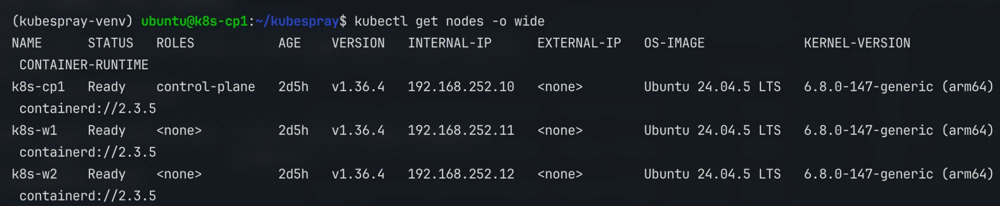

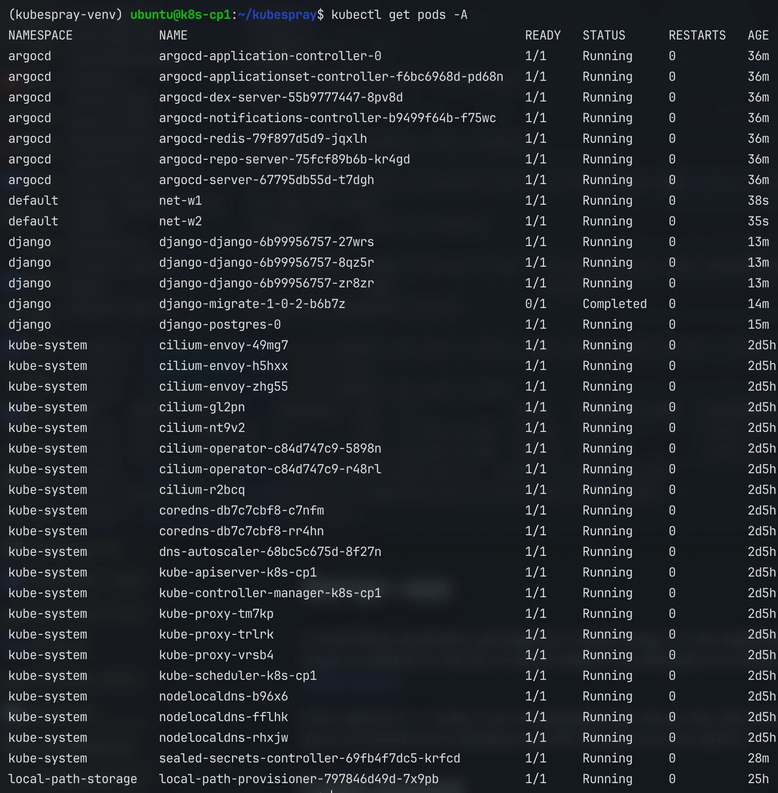

Cilium status and pod-to-pod traffic between workers:

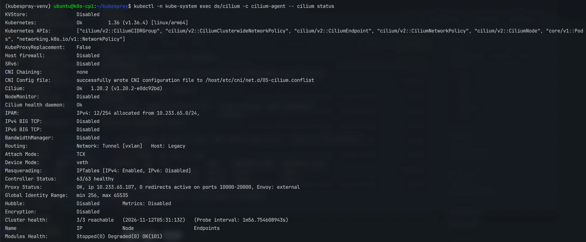

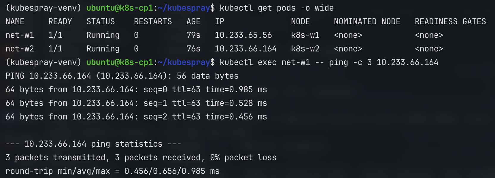

Application in namespace `django`:

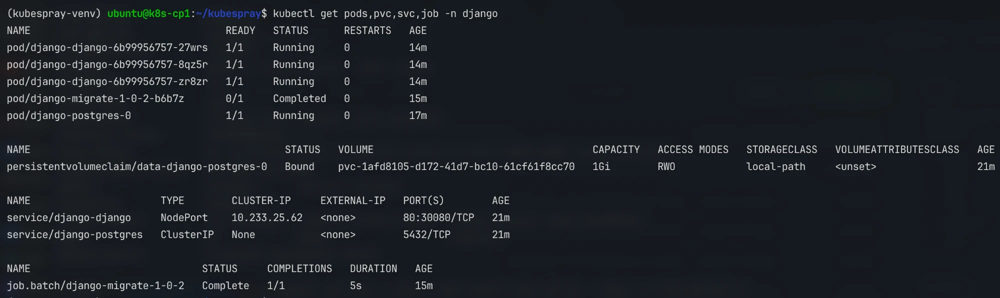

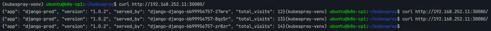

Argo CD Application (Synced, Healthy) and its resource tree:

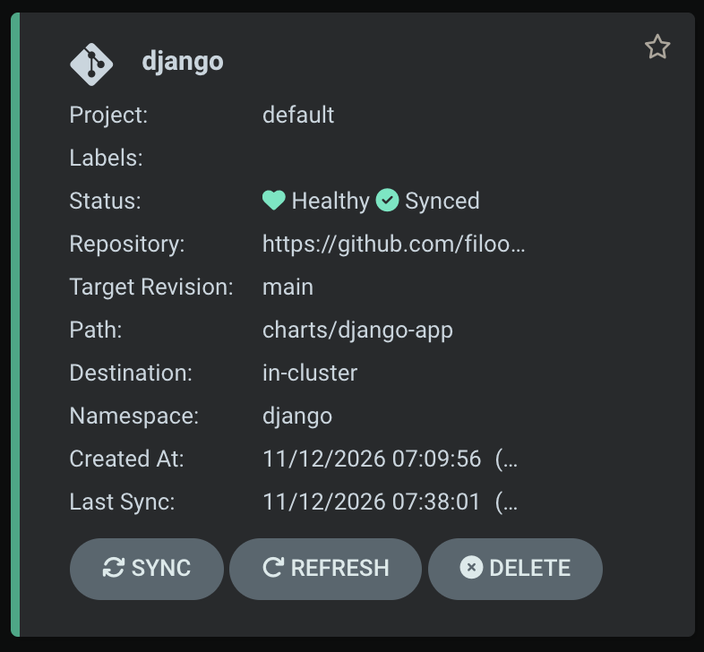

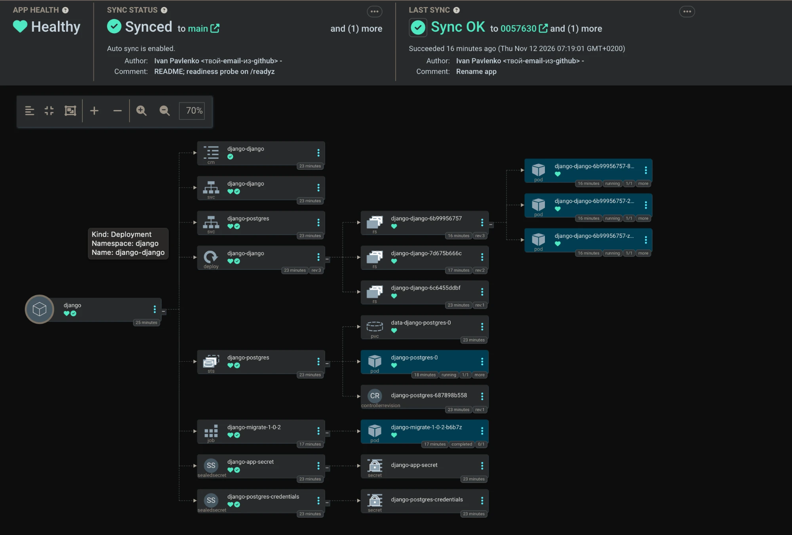

Scaling through Git and self-heal:

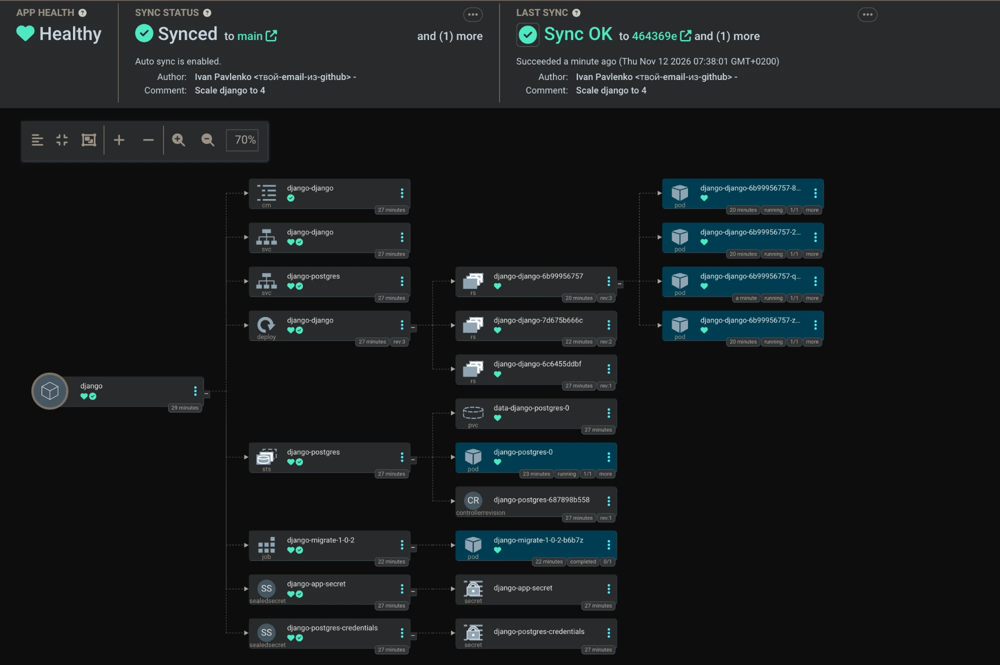

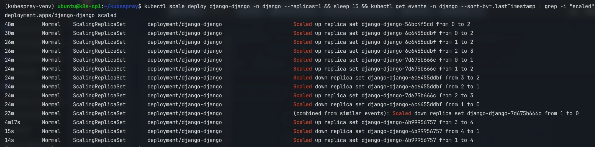

Data survives a PostgreSQL pod restart:

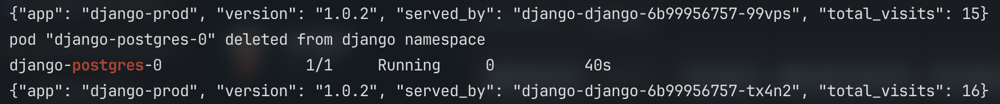
